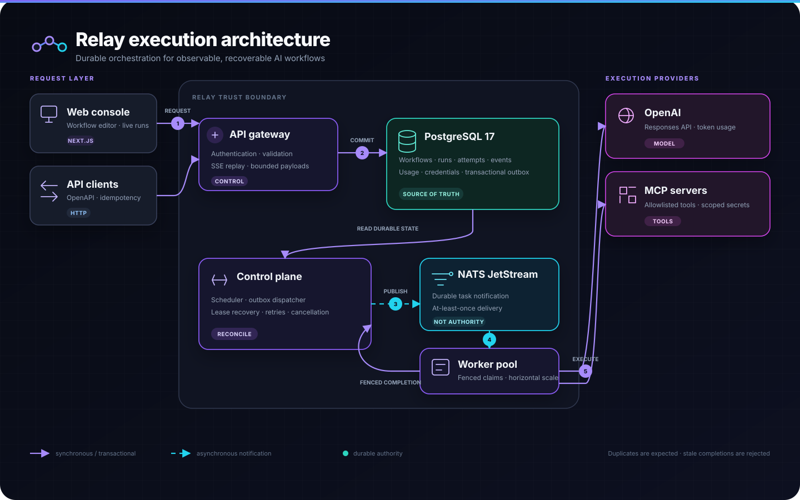

<div align="center">
  
  <h1>Relay</h1>
  <p><strong>A durable execution engine for AI agent workflows.</strong></p>
  <p>Versioned DAGs · crash-safe workers · replayable events · observable costs</p>

  [](https://github.com/jonxsong/Relay/actions/workflows/ci.yml)
  [](https://go.dev/)
  [](https://www.postgresql.org/)
  [](https://nats.io/)
  [](LICENSE)
</div>

> [!IMPORTANT]
> Relay is under active construction. The durable backend vertical slice is runnable with the deterministic mock provider; the developer console, production authentication, and full integration suite are still being built. Do not deploy it to production until the security and recovery acceptance suites are green.

Relay turns an immutable workflow definition into a durable, inspectable run. PostgreSQL owns the truth. NATS JetStream wakes workers up. Every claim is fenced, every retry is bounded, and every user-visible state change is recorded as a replayable event.

## Why Relay

Most agent demos stop at orchestration. Relay starts where the happy path ends:

| Promise | How Relay earns it |
| --- | --- |
| Survives worker crashes | Leased attempts, fencing tokens, and recovery scans |
| Handles duplicate delivery | Transactional claims and stable message deduplication IDs |
| Explains every run | Append-only events, structured logs, attempts, traces, and usage |
| Executes DAGs concurrently | Dependency-aware scheduling with per-run and global limits |
| Controls AI risk | Typed outputs, budgets, deadlines, allowlisted tools, permission gates |
| Never overclaims | At-least-once dispatch; external side effects are not exactly-once |

## Architecture

<picture>
  <source media="(prefers-color-scheme: dark)" srcset="docs/assets/relay-architecture.svg">
  
</picture>

The diagram is intentionally hand-drawn: the runtime is strict, but the mental model should stay approachable. See [Architecture](docs/architecture.md) for invariants and [ADR-0001](docs/adr/0001-postgres-source-of-truth.md) for the core durability decision.

## Five-minute quickstart

The complete Compose quickstart will land with the first runnable vertical slice. Its stable contract is:

```bash
cp .env.example .env
docker compose up --build
```

Then verify the API:

```bash
curl http://localhost:8080/api/v1/health/ready
```

The deterministic mock model is the default. The browser console and opt-in live OpenAI provider are still in progress and are not required for local execution.

## The execution contract

```text
define immutable version
        ↓
submit run + idempotency key
        ↓
schedule ready nodes in one database transaction
        ↓
publish outbox records to JetStream
        ↓
claim fenced attempt → execute → commit completion
        ↓
append event → unlock dependants → stream replay to UI
```

- PostgreSQL is authoritative; JetStream is a dispatch accelerator.
- A worker completion is accepted only for the current lease fencing token.
- Run and node transitions are explicit and validated.
- Cancellation is durable and prevents new work; already-started external side effects may still finish.
- Pricing is configuration, not code. Unknown model pricing produces unknown cost, never a guess.

## Repository map

```text
cmd/api              HTTP API and SSE
cmd/controlplane     scheduler, outbox dispatcher, recovery
cmd/worker           isolated node executor
internal/domain      workflow and state-machine invariants
internal/store       PostgreSQL transactions and generated queries
internal/ai          model provider boundary
internal/mcp         allowlisted tool execution
internal/telemetry   traces, metrics, structured logging
migrations           Goose SQL migrations
web                  Next.js developer console
examples             runnable workflow definitions
deploy               local and production deployment assets
docs                 architecture, ADRs, threat model, operations
```

## Development

Relay targets Go 1.27.4, Node.js 24, PostgreSQL 17+, and NATS JetStream. Local development is container-first so host toolchain drift does not change test results.

```bash
make bootstrap
make test
make dev
```

Exact commands and verified results are recorded as milestones land. See [Implementation plan](docs/implementation-plan.md) for scope and acceptance gates.

## Reliability, without mythology

Relay provides durable state transitions and duplicate-safe execution bookkeeping. It deliberately does **not** claim exactly-once execution or exactly-once external side effects. Tool authors should provide idempotency keys or compensating actions when a side effect matters.

## Security posture

- Credentials are referenced, never embedded in workflow JSON.
- LLM and tool output is untrusted and size-bounded.
- Remote MCP endpoints are allowlisted and protected against SSRF.
- Side-effecting tools require an explicit permission decision.
- Logs, traces, and API errors pass through redaction.

The full threat model and deployment hardening guide will be acceptance-gated before the production-ready milestone.

## Project status

| Area | Status |
| --- | --- |
| Architecture and ADRs | 🟢 Implemented |
| Domain invariants | 🟢 Implemented and unit tested |
| Durable scheduler and recovery | 🟡 Implemented; integration tests in progress |
| OpenAI and MCP adapters | ⚪ Planned |
| Developer console | ⚪ Planned |
| Integration, browser, and load tests | ⚪ Planned |

## Contributing

Small, reviewable commits are preferred. Start with [CONTRIBUTING.md](CONTRIBUTING.md), preserve the durability invariants, and include a test that would fail without your change.

<div align="center">
  <sub>Built for the awkward moment between “the demo worked” and “the service stayed up.”</sub>
</div>

